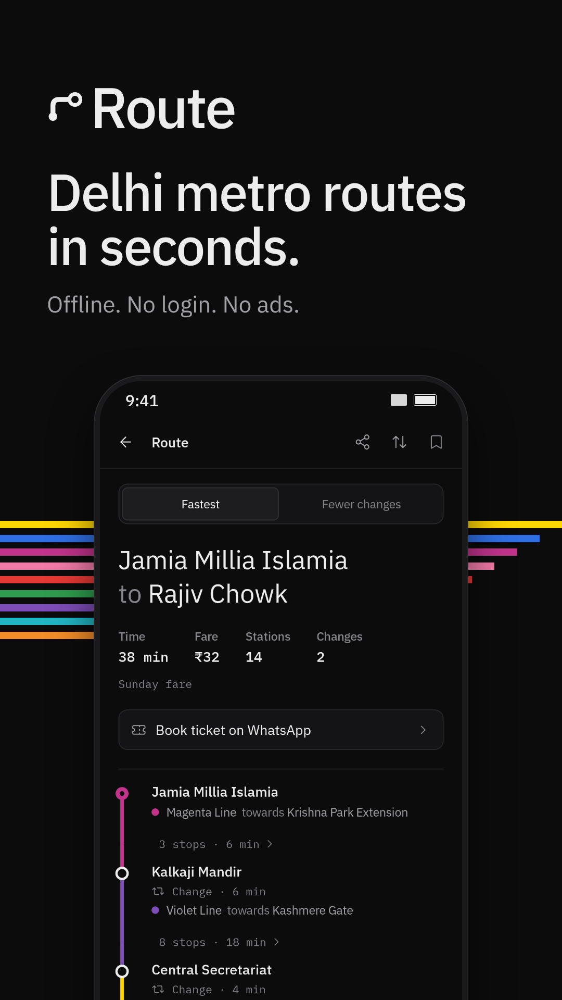
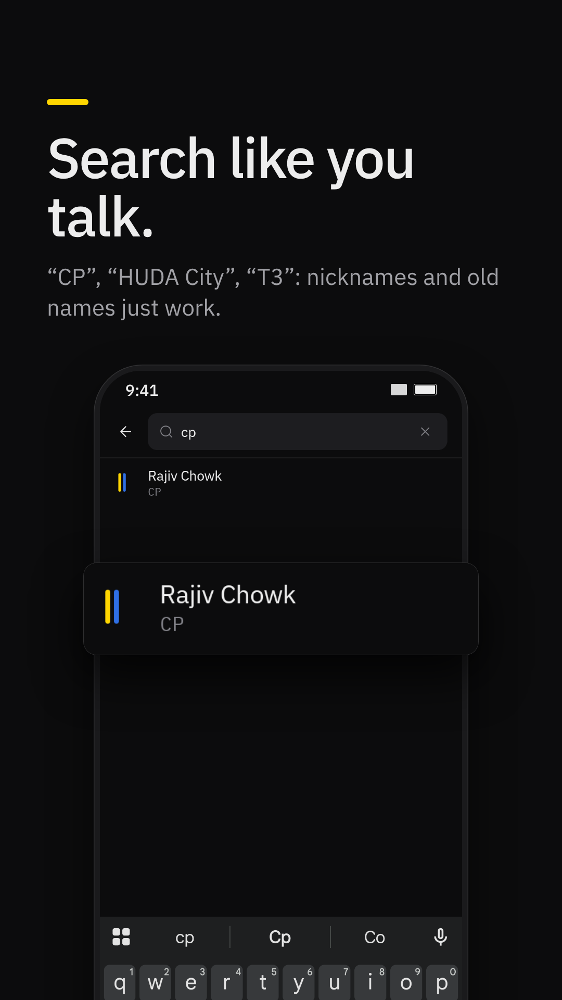
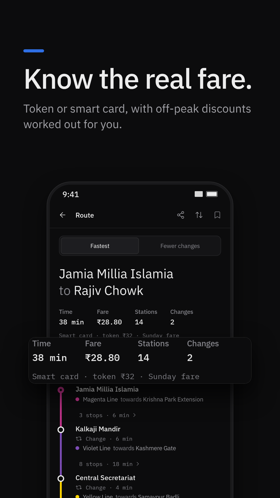
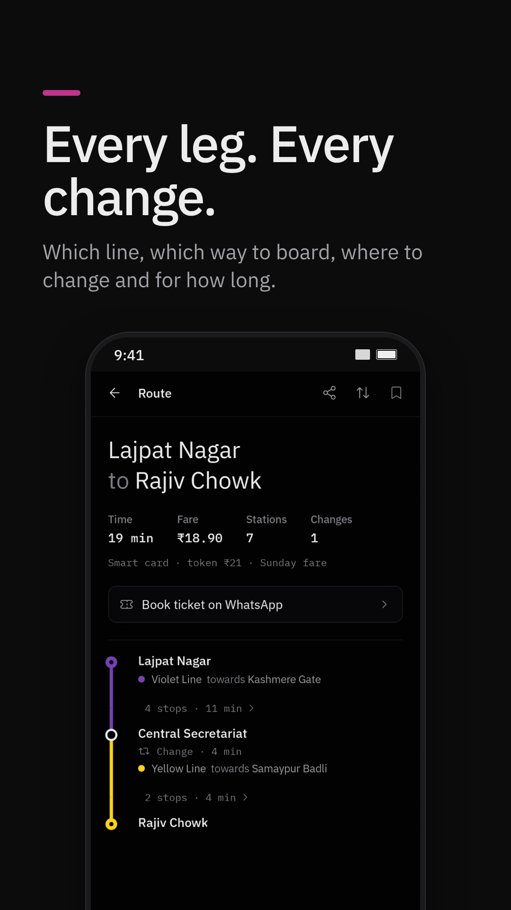
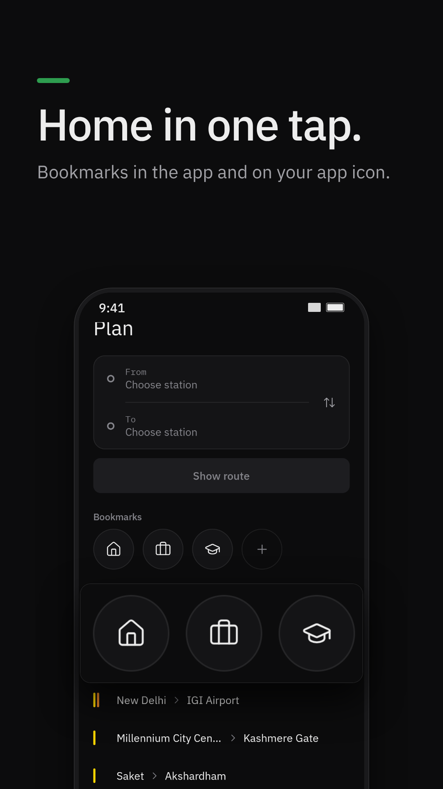
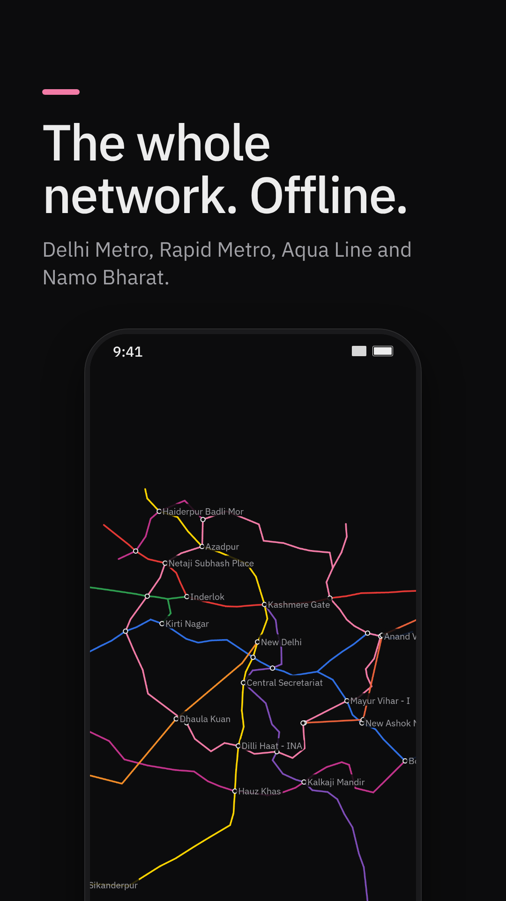
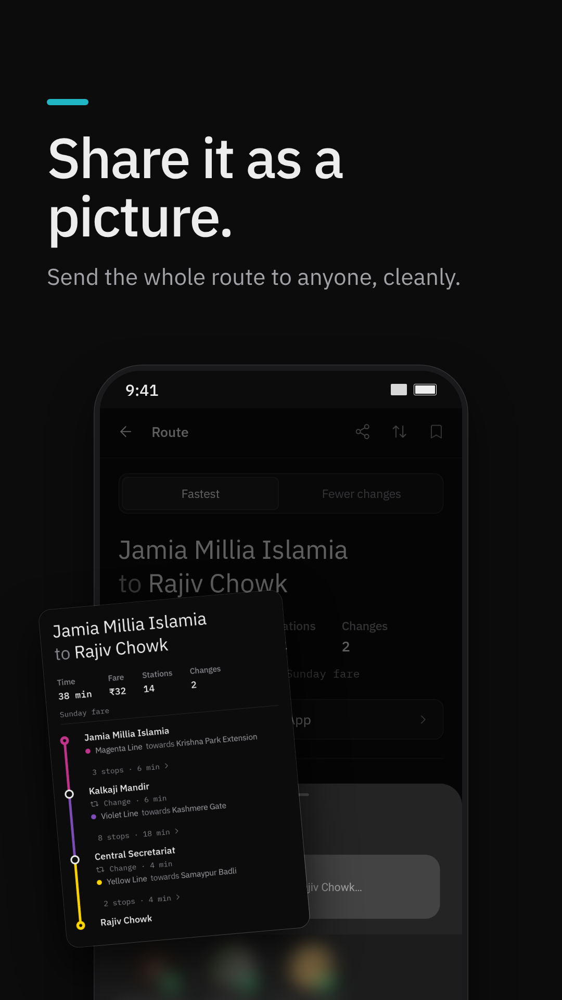
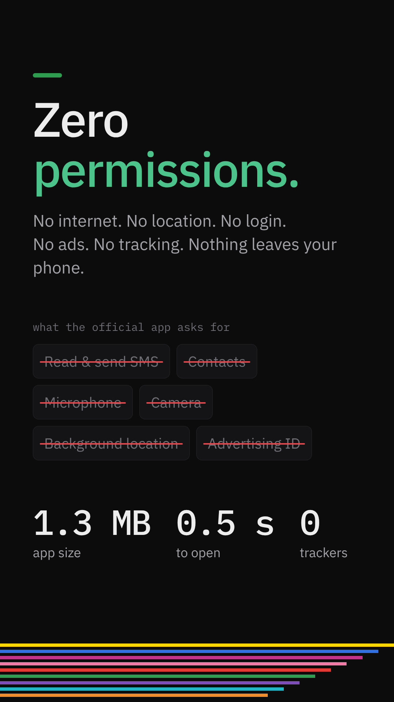

# Route

**Delhi NCR metro routes in seconds. Offline. No login. No ads. No spying.**

Pick two stations, get the route: which line, which direction, where to change, how long, how
much. That's the app. Delhi Metro, Rapid Metro Gurugram, Noida Aqua Line and Namo Bharat.

<p align="center">
  
  
  
  
</p>
<p align="center">
  
  
  
  
</p>

## Why this exists

The official DMRC app makes you sign in, shows you sponsored ads and a spin-the-wheel before it
shows you a train, and asks for permissions a route planner has no business having. Route does
one job and does it fast.

| | **Route** | Official DMRC app (v2.2.7) |
|---|---|---|
| Open app → search → see route | **~5 s** | ~30 s |
| Login | **None** | Required |
| Ads | **None** | Sponsored ads, spin wheel, cashback offers |
| Permissions | **None** | 30+, including SMS (read & send), contacts, microphone, camera, background location, advertising ID |
| Internet access | **None — it can't phone home** | Yes |

<sub>Timings hand-measured on a Redmi 12 5G. Permissions read from the installed DMRC app.</sub>

## What you get

- **Fastest** and **fewer changes** routes, plus Airport Express when it's quicker
- Time, fare, stations and changes at a glance, with every leg drawn in its line colour
- Which way to board ("towards Noida Electronic City") and how long each change takes
- **Smart card fares** — 10% off, 20% off-peak — or token fares
- Search the way people talk: **"CP"**, **"HUDA City"**, **"Race Course"**, **"T3"**
- **Bookmarks** — Home, Work, College, Gym. One tap starts your trip there. Hold the app icon
  for "From Home"
- Network **map**, every line, every station
- **Share a route** as a clean picture, directions included as text
- Need a ticket? One tap opens DMRC's official WhatsApp ticketing. Payment stays between you and
  DMRC

## Privacy

Route asks for **zero permissions**. No internet, no location, no contacts, no analytics, no
accounts. Your bookmarks and trips live on your phone and are excluded from cloud backup. There
is nothing to leak because nothing leaves the device.

## Fast, for real

- 1.3 MB app, opens in about half a second
- Routes calculated instantly on the phone — no server round trip
- Map pans at full frame rate
- Uses zero battery in the background: no services, no jobs, no alarms

## Install

1. Download the latest `.apk` from [Releases](../../releases) on your phone.
2. Open it and allow installs from your browser or file manager when Android asks.
3. If Play Protect warns about an unknown app, tap **Install anyway**.

Android 8.0 or newer.

## Accuracy

Stations and lines come from OpenStreetMap. Times are calibrated against the official app; Delhi
Metro fares follow DMRC's distance slabs. Noida Metro and Rapid Metro cross-phase fares are
marked ≈. Airport Express and Namo Bharat fares aren't included yet.

## Build

JDK 17 + Android SDK:

```bash
./gradlew :app:testDebugUnitTest :app:assembleRelease
```

To sign releases, put your keystore details in `keystore.properties` (`storeFile`,
`storePassword`, `keyAlias`, `keyPassword`); it's git-ignored. Without it, builds use the debug key.

New stations opened? Refresh the network:

```bash
python3 tools/fetch_osm.py && python3 tools/build_network.py
```

## Credits

Map data © OpenStreetMap contributors (ODbL) · Icons: Lucide (ISC) · Fonts: IBM Plex (OFL) ·
Design direction: [unslop](https://github.com/heydamir/unslop) by Damir Sokolovsky (CC BY 4.0).
Details in [THIRD_PARTY_NOTICES.md](THIRD_PARTY_NOTICES.md).

Not affiliated with DMRC, NMRC, NCRTC or Rapid Metro Gurugram.
